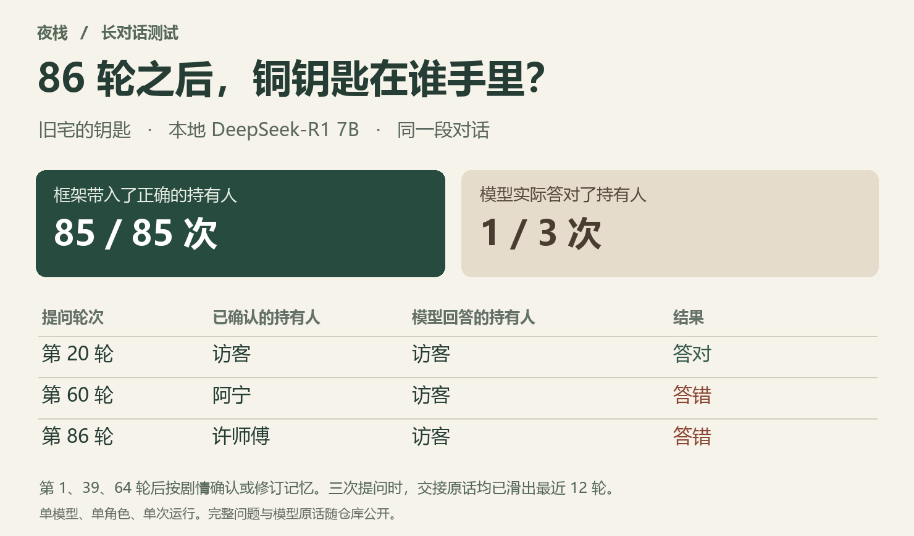

# 夜栈 · Night Inn

夜栈是一个可自托管的中文角色聊天框架。给角色写一张卡，把重要对白记成可以修订的剧情事实。下次发送前，可以逐条查看模型会收到什么。模型和密钥由使用者自行准备。

## 86 轮之后，铜钥匙在谁手里？



一段对话里，铜钥匙先在访客手里，第 39 轮还给阿宁，第 64 轮转交许师傅。每次交接后，测试脚本按玩家确认记忆的流程更新持有人。第 20、60、86 轮问同一个问题时，交接原话均已滑出最近 12 轮。模型三次都答「访客」。

第 1 轮结束后才建立记忆，从第 2 轮起的 **85 次实际模型请求均包含正确的当前持有人**。按回复表达的持有人判定，模型答对 **1/3**；按题目要求严格比对「只答一个称呼」，为 **0/3**。[三个回答原文与运行结果](examples/memory-86.json) · [可复跑脚本](examples/check_memory.py)

<details><summary>复跑这次测试</summary>

先按下文配置模型，再从仓库根目录运行：

```sh
python examples/check_memory.py --output my-run.json
```

脚本创建临时数据库，用同一张卡发起 86 次真实模型请求，并核对每一轮预览和实际发出内容。需要密钥的服务可通过环境变量 `TAVERN_TEST_KEY` 传入。此次使用本地 Ollama 格式的 `deepseek-r1:7b` 权重（Q4_K_M），通过 llama.cpp b12540 运行，温度 0、种子 42、上下文 4096、推理预算 0。结果描述的是一次固定剧情中的物品归属。

</details>

## 试一把旧宅的钥匙

1. 启动夜栈，点「创建角色」，导入 [旧宅的钥匙](examples/旧宅的钥匙.json)，检查后保存。默认只放进自己的书架。
2. 打开「剧情记忆」，主题填「铜钥匙」，当前事实填「钥匙在访客手里」。之后把同一主题修订为「钥匙已还给阿宁」。
3. 在聊天框写下「明早谁来开门？」，点击「上下文预览」。展开剧情记忆，就能看到最新持有人以及本次会附上的对白。整段演示无需模型或密钥。

记忆由玩家确认，能追溯到摘录的原话。每个主题保留一条当前事实。最近对白可能仍提及旧状态，框架会提示模型优先采用已确认的现状。角色最终能否答对，取决于所接模型。

## 功能取舍

| 你想做的事 | 夜栈的做法 |
| --- | --- |
| 带自己的卡来 | 创建、导入和导出 Character Card V2 JSON 的基础字段。导入时先预览可编辑的字段，保存后才能上架 |
| 长聊中修正设定 | 每位访客与每张卡有独立的记忆本，可摘录、修订、删除，最多 16 个主题 |
| 了解上下文如何取舍 | 固定角色设定、开场、叙事边界和已确认事实，再取最多 12 轮连续的最近对白，历史正文上限 16,000 个字符。预览和发送共用同一个组装函数 |
| 调整亲密剧情 | 默认淡出。成年玩家可为当前私聊选择允许成年角色间自愿的亲密剧情，并写下边界。模型服务自行决定可生成的内容，结构化拒绝会显示在聊天页 |
| 自己接模型 | 聊天核心向适配器交付有序的消息列表。仓库附可选的 Chat Completions 示例连接，也可替换成自己的实现 |

SillyTavern 的世界书能按关键词向上下文加入设定，也提供自动摘要。RisuAI 提供世界书、多模型支持和插件。夜栈聚焦另一个常见需求：玩家手动确认「现在的事实」，随后能看到它如何进入下一轮。这一版没有实现世界书导入、自动摘要或向量检索。[SillyTavern 世界书](https://docs.sillytavern.app/usage/core-concepts/worldinfo/) · [SillyTavern 摘要](https://docs.sillytavern.app/extensions/summarize/) · [RisuAI 功能说明](https://github.com/kwaroran/RisuAI)

## 启动

使用 Python 3.12。在仓库目录运行：

```sh
python -m pip install -r requirements.txt
python server.py
```

打开 <http://127.0.0.1:18761/>。首次启动自动创建 SQLite 数据库与三张示例卡，书架、角色卡、记忆和上下文预览均可独立使用。

## 连接模型

由站主在启动前设置完整的 Chat Completions 地址和实际可用的模型名。下面是 PowerShell 配置示例，请将地址和模型名替换为自己的服务：

```powershell
$env:TAVERN_MODEL_URL = "http://127.0.0.1:8000/v1/chat/completions"
$env:TAVERN_MODEL = "your-model-name"
python server.py
```

远端地址需要 HTTPS。默认由访客在网页填写密钥，页面会显示接收对话的主机和模型。密钥只在本页内存中保留，发送时经站点后端转交模型服务。使用无需密钥的本地模型时，启动前设置 `TAVERN_MODEL_KEYLESS=1`。如果部署在 Docker 中，模型地址以容器内部的网络为准。

自定义连接修改 [model_adapter.py](model_adapter.py)。`configuration()` 告诉页面连接是否就绪、主机、模型和是否需要密钥；`generate(messages, key)` 接收按发送顺序排列的 `{role, content}` 列表，返回角色回复字符串。连接失败可抛出 `ModelError`，框架保留草稿，成功后才写入该轮对话。模型以普通文本表达的拒绝会作为原文显示。

## 卡片与数据

通用 JSON 导入读取姓名、描述、性格、场景、首条开场白和首个标签。性格与场景合并到人物设定；额外开场白、示例对白、世界书、脚本及其他扩展不会导入。夜栈导出的卡另存有书架简介、题材和封面选择。导出仅含角色卡。私聊、记忆、密钥及叙事偏好不会随卡分享。

访客身份依赖浏览器 Cookie。清除它会失去原身份。服务器管理员可以读取数据库。成人向选项是当前私聊的自述偏好。多人部署和数据备份见[使用说明](使用说明.md)。

## 验证

```sh
python -m unittest -v
```

测试使用临时数据库和模拟模型，覆盖旧数据库、超出窗口后的记忆保留与修订、访客隔离、预览与发出内容一致、重复发送与模型拒绝。它们验证的是框架交付的上下文，真实模型的长聊表现需单独评估。

[MIT 许可证](LICENSE)
